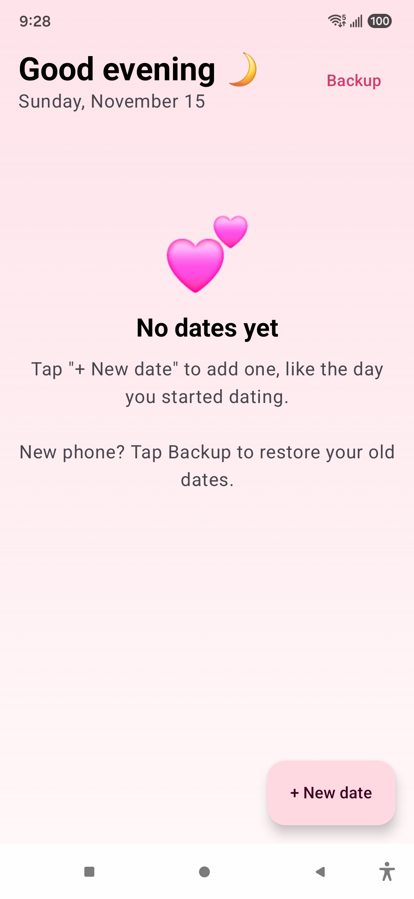
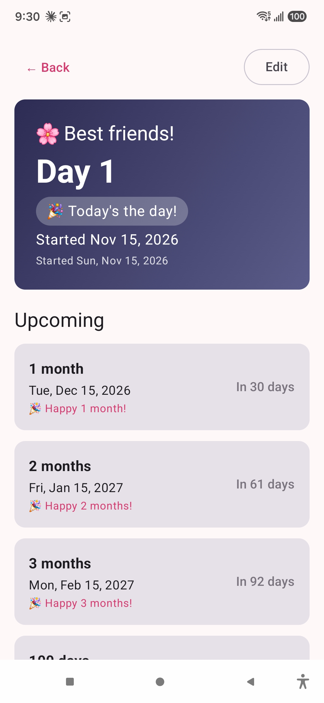
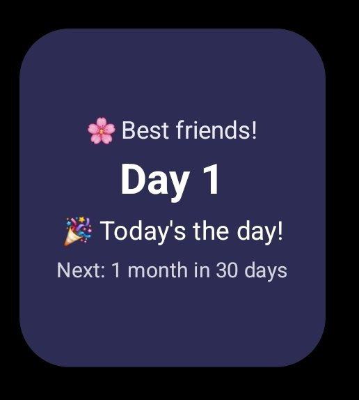

# 💕 Milestones

An Android app that counts up from the dates that matter (the day you started dating, a birthday, a streak) and celebrates every milestone along the way.

> 🎉 **Happy 3 months!** shows up on your home screen widget, in a notification, and in the app, right on the day.

<!-- Add screenshots to docs/screenshots/ and they will show here -->
<p align="center">
  
  
  
</p>

---

## ✨ Features

| Feature | What it does |
|---|---|
| 📅 **Count up from any date** | Add as many dates as you want, each with its own name |
| 🔁 **Live or Milestones only** | Live updates every day ("2 months, 1 day"). Milestones only changes once per span ("2 months") |
| 📏 **Count in days, weeks, months or years** | Pick whatever fits the date |
| 🎉 **Celebrations** | Monthly and yearly anniversaries, every 100 days, and weekly (if counting in weeks) |
| 💬 **Custom messages** | Write your own, e.g. `Happy {n} {unit}, babe! ❤️` becomes "Happy 3 months, babe! ❤️" |
| 🔮 **Upcoming milestones** | See the next 5 milestones with dates and countdowns |
| 🔔 **Notifications** | A reminder around 9 AM on milestone days, plus an optional heads-up the day before |
| 🏠 **Home screen widget** | Resizable widget that updates just after midnight |
| 🎨 **Emoji and colour per date** | 10 quick-pick emojis (or type your own) and 8 gradient colours |
| 📸 **Memories timeline** | Save a note and a photo for each milestone |
| 💾 **Backup and restore** | Export everything (dates, memories, photos) to one `.zip` and restore it on any phone |

---

## 📲 Download and install

1. Go to the [**Releases**](../../releases) page and download the latest `app-release.apk` on your Android phone.
2. Open the file. If Android asks, tap **Settings > Allow from this source**.
3. Tap **Install** (Samsung may show a warning: tap **Install anyway**).

**Requirements:** Android 8.0 or newer.

**Updating:** install the new APK over the old one. Your dates and memories are kept.

---

## 🧮 How milestones are calculated

Example: a start date of **September 13**.

| Date | Shows | Celebration |
|---|---|---|
| Sep 14 | 1 day | |
| Oct 13 | 1 month | 🎉 Happy 1 month! |
| Dec 22 | 3 months, 9 days | 🎉 Happy 100 days! |
| Sep 13 (next year) | 1 year | 🎉 Happy 1 year! |

- **Short months are handled:** a start date of Jan 31 celebrates "1 month" on Feb 28.
- **When two milestones land on the same day**, the bigger one wins: years, then every 100 days, then months, then weeks.
- **Future dates** count down instead ("In 5 days").

---

## 🔒 Privacy

Everything stays **on your phone**. There are no accounts, no servers, no ads and no tracking.
- Dates and memories are saved in the app's private storage.
- Photos are copied into the app's private folder, so they stay even if you delete them from your gallery.
- Backups only go where **you** choose to save them.

---

## 🛠️ Built with

- **Kotlin** and **Jetpack Compose** (Material 3)
- **App widgets** with `RemoteViews`
- **AlarmManager** for the midnight widget refresh and the 9 AM notification check
- **SharedPreferences + JSON** for storage
- **Android Photo Picker** (no storage permission needed)
- `java.time` for all date math

---

## 🗂️ Project structure

```
app/src/main/java/com/nathan/milestones/
├── MainActivity.kt          Screen navigation
├── model/                   Counter, Memory, colours and emojis
├── logic/                   MilestoneCalculator (all the date math)
├── data/                    Saving dates and memories, backup and restore
├── ui/                      List, detail, edit, memory and backup screens
├── widget/                  Home screen widget, picker, midnight refresh
└── notify/                  Milestone notifications
```

---

## 🧑‍💻 Build it yourself

1. Clone the repo and open it in **Android Studio**.
2. Let Gradle sync.
3. Press **Run**. The debug build installs as **Milestones Dev**, separate from the real app, so testing never touches your real data.

To build a release APK: **Build > Generate Signed App Bundle or APK > APK**, using your own signing key.

---

## 🗺️ Roadmap

- [ ] Confetti on milestone days
- [ ] Small 1x1 widget
- [ ] Countdown widget ("29 days until 3 months")
- [ ] Custom one-off milestones (e.g. "First trip together")
- [ ] Optional pink app theme

---

Made with ❤️ by [Tenzukun](https://github.com/Tenzukun)